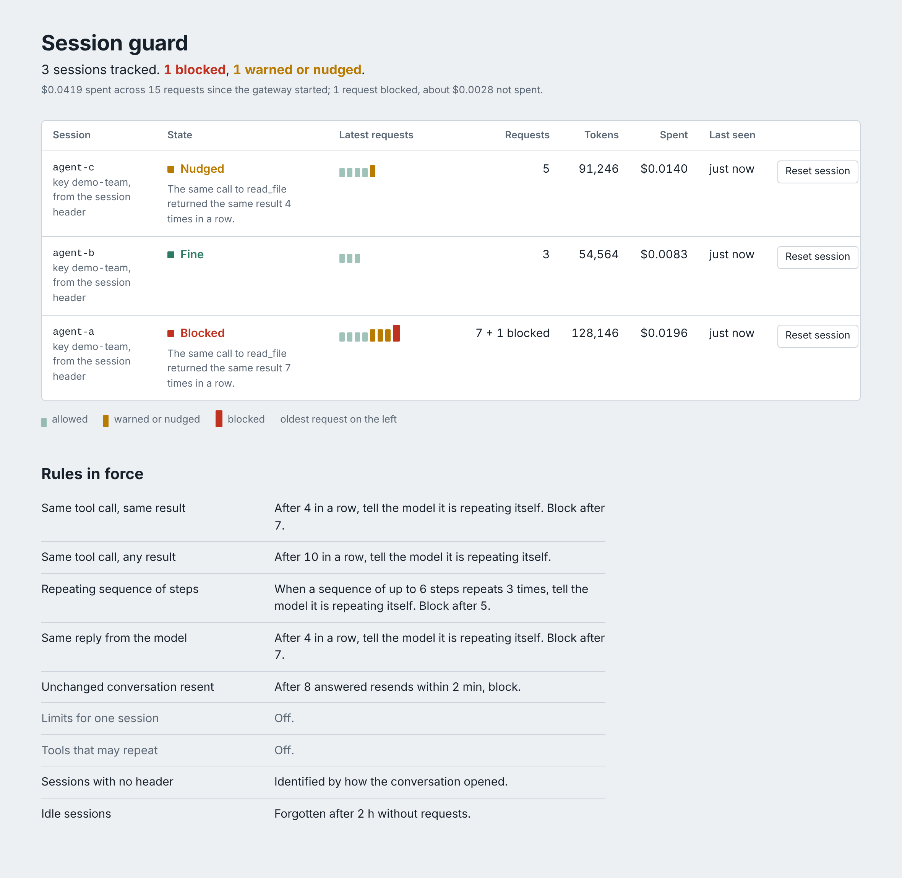

# Bifrost session guard

A plugin for the [Bifrost](https://github.com/maximhq/bifrost) AI gateway that stops a runaway agent session before it spends a whole team's budget.

Built for the Global AI Hackathon, Bifrost track, problem statement 04 ("Build a feature the open-source gateway is missing").



## The problem

Agents get stuck. A coding agent re-reads a file that does not exist, or edits a file, runs the tests, sees the same failure and edits it the same way again. Each turn resends the whole conversation, so a stuck agent is also an expensive one.

Bifrost can cap spend, but its budgets and rate limits belong to a virtual key, a team, a provider or a model. None of them belongs to a session. So when one agent loops:

1. Nothing stops it until the shared budget is gone.
2. Once the budget trips, Bifrost refuses **everyone** on that key, including the agents that were working normally.

Bifrost already knows which session a request belongs to. It reads `x-bf-session-id`, and the header that Claude Code, Codex CLI and OpenCode send on their own. Today it uses that only to keep a session on the same provider key.

## What the session guard does

It watches each session on its own and steps in for that session only.

- **Finds loops.** The same tool call returning the same result, a sequence of steps going round in circles, the model giving the same reply, or a client resending an unchanged conversation.
- **Tells the model first.** At the first sign of a loop it adds a short notice to the system prompt, saying what is repeating and that repeating it will not help. That gives the model a chance to change course by itself.
- **Blocks if that fails.** If the loop continues, the session gets an error that client libraries do not retry by default. Other sessions on the same key carry on.
- **Caps a session.** Optional limits on requests, tokens, cost and duration for one session.
- **Shows what it did.** Response headers on every request, a line in Bifrost's own request log, and a small status page.

No client changes are needed. Sessions come from the headers Bifrost already understands. When a request has none, the guard identifies the conversation by how it opened.

## Run the demo

The demo needs no API keys. A scripted mock stands in for the model provider, so no request reaches a real model and nothing is spent. Prices are the catalog prices for `gpt-4o-mini`, which the gateway downloads when it starts.

With Docker, on any system:

```bash
docker build -t bifrost-session-guard .
docker run --rm -it -p 8080:8080 -p 9797:9797 bifrost-session-guard
```

Or directly on Linux or macOS, with Go 1.21+, Node 20+, git and a C compiler:

```bash
make demo
```

On Windows use Docker or WSL, because Go plugins are not supported there. The first build compiles the gateway from source and takes about five minutes on a clean machine (about nine with Docker). After that the demo runs in about 20 seconds.

The demo runs the same two agents twice on one virtual key with a $0.06 daily budget. Agent A is stuck re-reading a missing file. Agent B does normal work.

Without the guard, agent A runs for 22 turns until the budget is gone, and agent B is then refused on its first request:

```
Agent A (stuck):
  turn  1  read_file({"path":"config.yaml"})  ->  error: config.yaml: no such file or directory
  ...
  turn 22  read_file({"path":"config.yaml"})  ->  error: config.yaml: no such file or directory
  turn 23  HTTP 402
           Budget exceeded: vk_model_config * budget exceeded: 0.0625 >= 0.0600 dollars

Agent B (normal work), on the same key:
  turn  1  HTTP 402
           Budget exceeded: vk_model_config * budget exceeded: 0.0625 >= 0.0600 dollars
```

With the guard, agent A is told it is repeating itself on turns 5 to 7 and stopped on turn 8. Agent B finishes its work:

```
Agent A (stuck):
  turn  4  read_file({"path":"config.yaml"})  ->  error: ...   [guard: allow]
  turn  5  read_file({"path":"config.yaml"})  ->  error: ...   [guard: nudge · repeat_tool_call]
  turn  6  read_file({"path":"config.yaml"})  ->  error: ...   [guard: nudge · repeat_tool_call]
  turn  7  read_file({"path":"config.yaml"})  ->  error: ...   [guard: nudge · repeat_tool_call]
  turn  8  HTTP 403   [guard: block · repeat_tool_call]
           Session guard stopped session agent-a: the same call to read_file returned the
           same result 7 times in a row. Change the approach or ask the user how to proceed;
           sending the same conversation again will be blocked again.

Agent B (normal work), on the same key:
  turn  3  answer: The project is a small demo service. ...   [guard: allow]

session   state     requests  blocked  nudges  tokens    spent
agent-a   blocked   7         1        3       128146    $0.0196
agent-b   ok        3         0        0       54564     $0.0083
agent-c   nudged    5         0        1       91246     $0.0140
```

Agent C is a third agent that stops by itself as soon as it reads the notice. The stuck agent cost $0.0196 where it had cost $0.0625, and the key stayed usable.

The Docker command leaves the guarded gateway running, as does `demo/run.sh --keep`. The status page is at http://127.0.0.1:9797 and Bifrost's own dashboard at http://127.0.0.1:8080.

## How it meets the brief

| Requirement in problem statement 04 | How this project meets it |
| --- | --- |
| Real operator problem, solved end to end | One stuck session can drain a shared budget and lock out a team. The guard detects it, intervenes, reports it and lets an operator reset it. |
| Public extension points | A standard Bifrost plugin. It uses `PreLLMHook`, `PostLLMHook` and the HTTP transport hooks, and nothing private. It imports only Bifrost's `core/schemas` package. |
| Reproducible integration with clear setup | One command builds a plugin-capable gateway from Bifrost's own source at a pinned release (v2.5.0), builds the plugin and checks the two against each other. `make demo` and `make e2e` then run against that gateway. See the note on builds below. |
| Tests, documentation, ready for an upstream pull request | 51 unit tests, 13 end-to-end tests against the real gateway, benchmarks, this README, a [configuration reference](docs/configuration.md) and an [upstream plan](docs/upstream.md). A 20-line patch registers the guard as a built-in; with it, the same 13 tests pass on a statically linked gateway. |

**A note on builds.** The gateway binary Bifrost publishes is statically linked and cannot load any custom plugin. Bifrost's documentation asks plugin users to build the gateway with dynamic linking, and that is what `make gateway` and the Dockerfile do, from unmodified Bifrost source. Go also refuses to load a plugin unless every package it shares with the gateway is the same version. `scripts/build-plugin.sh` compares the two binaries and names any package that differs, so that mistake fails at build time with a clear message.

There is a second route with none of those constraints: `make gateway-builtin` compiles the guard into the gateway, the way an upstream merge would. See [Upstream](#upstream).

## Use it on your gateway

Build the gateway and the plugin for your Bifrost version:

```bash
make all            # .work/bin/bifrost-http and build/session-guard.so
```

Add the plugin to Bifrost's `config.json`:

```json
{
  "plugins": [
    {
      "name": "session-guard",
      "enabled": true,
      "path": "/path/to/session-guard.so",
      "config": {
        "limits": { "max_cost_usd": 5, "max_duration": "4h" },
        "status": { "listen": "127.0.0.1:9797" }
      }
    }
  ]
}
```

Every setting has a default, so `"config": {}` works. To try it safely on live traffic, start with `"dry_run": true`: the guard reports what it would do and never interferes.

To move to another Bifrost release, run `scripts/sync-deps.sh v2.x.y` and rebuild. Everything here was tested end to end on v2.5.0. The plugin also compiles and passes its unit tests against v2.4.0.

## Configuration

The settings you are most likely to change. The [configuration reference](docs/configuration.md) has all of them.

| Setting | Default | What it does |
| --- | --- | --- |
| `dry_run` | `false` | Report only: never block or nudge. |
| `limits.max_requests`, `max_tokens`, `max_cost_usd`, `max_duration` | off | Caps for one session. |
| `loops.repeat_tool_call.threshold` | `4` | Identical tool calls with identical results, in a row, before the guard acts. |
| `loops.repeat_tool_call.action` | `"nudge"` | `"warn"`, `"nudge"` or `"block"`. |
| `loops.repeat_tool_call.escalate_after` | `3` | Block after this many more repeats. `0` never blocks. |
| `loops.tool_cycle.repeats` | `3` | Times a sequence of steps must repeat. |
| `loops.ignore_tools` | none | Tools that may repeat freely, such as `wait` or a status poll. |
| `session.fallback` | `"fingerprint"` | What to do with a request that has no session header. `"none"` leaves it unguarded. |
| `session.idle_ttl` | `"2h"` | How long an idle session is remembered. |
| `status.listen` | off | Address for the status page and API. |

## How it works

**Sessions.** The guard uses the session id Bifrost has already resolved from the request headers. With no header, it derives an id from the system prompt and the first user message. Agents resend their history on every turn, so that opening is the same for the whole conversation. Sessions are kept apart per virtual key.

**Loop detection reads the conversation, not a counter.** Every request carries the conversation so far, including each tool call and its result. The guard pairs calls with results and checks whether the end of that sequence repeats. That has three useful consequences:

- It needs no stored state, so every gateway replica reaches the same verdict.
- A person stepping in clears it naturally. A new user message means the end of the conversation no longer repeats.
- A blocked conversation stays blocked if the client simply sends it again.

A tool call counts as "the same" when the tool name matches and the JSON arguments differ only in whitespace or in the order of top-level keys. The text an assistant writes around a tool call is ignored, because models reword it ("let me try again") while repeating the same call.

**The nudge.** For a chat request the notice is appended to the system message. For a Responses request it goes into `instructions`. The caller's own messages are never modified; the guard works on a copy. Anthropic-format requests arrive in Bifrost as Responses requests and are handled the same way.

**The block.** A loop is refused with HTTP 403 and a limit with 402, the status Bifrost's own budgets use. Client libraries retry 429 and 5xx responses, so those would only make a stuck agent hammer the gateway. Fallback to other providers is switched off for a blocked request.

**Accounting.** After each call the guard adds the tokens and the cost Bifrost calculated to the session. A streamed response is counted once, on its final chunk.

## What a client sees

Every guarded response carries these headers:

| Header | Value |
| --- | --- |
| `x-bf-session-guard` | `allow`, `warn`, `nudge` or `block` |
| `x-bf-session-guard-rule` | The rule that fired, such as `repeat_tool_call` or `limit_cost` |
| `x-bf-session-guard-would` | In dry run, the action that was held back |
| `x-bf-session-guard-session` | The session id the guard used |
| `x-bf-session-guard-requests` | Requests the session has made |
| `x-bf-session-guard-cost-usd` | What the session has spent |

A blocked request gets this body, with status 403 for a loop or 402 for a session limit:

```json
{
  "type": "session_guard_loop_detected",
  "is_bifrost_error": true,
  "status_code": 403,
  "error": {
    "type": "session_guard_loop_detected",
    "code": "repeat_tool_call",
    "message": "Session guard stopped session agent-a: the same call to read_file returned the same result 8 times in a row. Change the approach or ask the user how to proceed; sending the same conversation again will be blocked again."
  }
}
```

Bifrost adds its usual `extra_fields` (provider, model, request type) to that body.

## Status page and API

Set `status.listen` to turn them on. They run on their own listener, so they work on any Bifrost build. Set `status.token` whenever the address is not a loopback address.

| Endpoint | What it returns |
| --- | --- |
| `GET /` | The status page |
| `GET /api/sessions` | Every tracked session |
| `GET /api/session?key=...` | One session |
| `GET /api/summary` | Totals and the configuration in force |
| `POST /api/reset` with `{"key": "..."}` | Forgets a session, clearing its counters and any limit it hit |

## Tests

```bash
make test          # 51 unit tests with the race detector, no gateway needed
make e2e           # 13 tests against the real gateway with the plugin loaded
make e2e-builtin   # the same 13 tests with the guard compiled into the gateway
make bench
```

The end-to-end tests start Bifrost v2.5.0 with the plugin loaded and drive it with scripted agents. They cover OpenAI-style chat, streamed chat, the Responses API, Anthropic-format requests, header and fingerprint sessions, isolation between sessions, resending a blocked conversation, dry run, session limits and the status API.

Measured on a 2-vCPU cloud VM (Xeon, 2.1 GHz): the pre-hook takes about 50 microseconds for a 400-message conversation whose tool results are 2 KB each, and the decision engine alone about 10 microseconds. Only the last 160 items of a conversation are examined, so the cost does not grow with conversation length.

## Limits

- **The nudge is untested on real models.** Every run so far used the scripted mock, which is written to change course when it reads the notice. How often a real model does has not been measured. The block does not depend on it.
- **Counters live in memory, per gateway process.** Loop detection is stateless and works across replicas. Session limits and the status page see only the requests that reached that replica, so exact per-session limits across replicas need sticky routing at the load balancer. A restart clears the counters.
- **Fingerprint sessions group identical openings.** Without a session header, requests with the same system prompt and first user message count as one session. Loop detection is unaffected, because it reads each request's own history. Session limits would add such requests together, so set `session.fallback` to `"none"` if you use limits and have a service that sends one fixed prompt.
- **Results that differ only by noise.** A tool result with a timestamp or request id in it is a different result each time. A second, looser rule catches the same call repeating ten times whatever it returns.
- **Stateful Responses API.** A client that sends `previous_response_id` instead of its history gives the guard nothing to read, so only session limits apply.
- **Nested key order.** Arguments that differ only in the order of keys inside a nested object count as different calls.
- **Raw-body passthrough.** When Bifrost forwards the caller's body untouched, the guard cannot add a notice, so a nudge becomes a warning.
- **Go plugin constraints.** Linux and macOS only, and the plugin must be rebuilt for each Bifrost release. Both come from Go's plugin system.

## Upstream

As a built-in plugin, the guard would work on Bifrost's standard binary with one line of configuration. `upstream/bifrost-v2.5.0-builtin.patch` is that change: 20 added lines in two files of the gateway.

```bash
make gateway-builtin          # a gateway with the guard compiled in
STATIC=1 make e2e-builtin     # the 13 end-to-end tests, on a statically linked build
```

[docs/upstream.md](docs/upstream.md) covers what a pull request would contain and the questions it leaves to the maintainers.

## How AI was used

The code, tests, demo and documentation in this repository were written with Claude (Anthropic), directed and reviewed by Aditya Vikram Singh. The plugin itself calls no model: it reads the conversations that pass through the gateway.

## Licence

Apache-2.0, the same licence as Bifrost.
